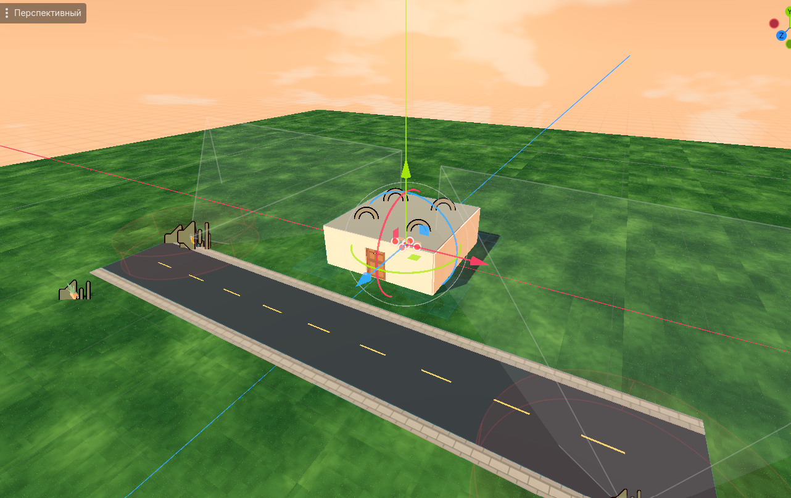

# Gacha Village

**▶ Play: https://severance.lol/3/**

Web deploy: `godot --headless --export-release "Web" build/web/index.html` then `scp build/web/* ubuntu@severance.lol:/var/www/severance/3/`

## Playable estate
The main scene (`node_2d.tscn`) is a third-person village shooter with the custom player character and an over-the-shoulder camera. Every player appears at a random spot inside the panel-housing estate already holding a foam pistol, and has to survive ten armed villagers roaming it. Villagers fire foam pellets, disappear when hit, and respawn after a short delay. The estate (`district.gd`) is laid out after a satellite map of a real Czech sídliště: long five-storey blocks (including the HOME block), eight-storey point towers, a supermarket with a pharmacy, parked cars, footpaths, trees and a quarter of red-roofed family houses, all surrounded by forest. Roads, paths and entrance steps lie flush with the ground and have no colliders, so you can run anywhere without jumping. Five of the panel blocks have an enterable ground-floor flat with an opening door and Cogito furniture (lounge chair, side table, open bookcase, rug, small plant, books, coffee mug).

### Multiplayer
Everyone who opens the game (web link or the Android APK) lands in the same world and sees the other players, with their names over their heads. Ten armed villagers roam the estate's roads and footpaths, loiter around, and shoot at whoever comes close; hit one and it vanishes and respawns somewhere far from all players. Doors are still per player.

- **Server**: `server/relay.js` (Node + `ws`) is a tiny WebSocket relay at `wss://severance.lol/village-ws`. It forwards each client's JSON messages to the others in the same room and picks one client as the *host*, which simulates the bots and streams their positions; if the host leaves or its tab goes to the background, another client takes over. Deploy/update with `server/deploy.sh` (systemd service `village-relay` on 127.0.0.1:8091 behind nginx).
- **Client**: `net.gd` (autoload `Net`) holds the connection, `net_world.gd` streams the local player and shows remote ones (`remote_player.gd`), `bot_crowd.gd` + `villager_walk.gd` run the bots. Without a server the game plays single-player as before.
- **Rooms / local server**: `?room=name` or `?server=ws://127.0.0.1:8091` on the web URL; on desktop `-- --room=name --server=ws://...`. `-- --net-debug` auto-starts and prints the network state every 2 s.

### Controls
- **WASD**: Move
- **Shift**: Run
- **Space**: Jump
- **Mouse**: Look around (vertical look is inverted by default)
- **E**: Open/close a flat's door while aiming at it
- **Q or left mouse button**: Fire a foam pellet (six shots per magazine)
- **R**: Reload the pistol
- **Health**: The game ends when your health reaches zero; use **Respawn** to drop back into the estate at a random spot.
- **Esc**: Release the mouse; click to capture it again
- **Android/mobile**: Use the on-screen joystick to move, drag on the right side to look, and tap **E** to interact. The on-screen buttons also provide jump, run, pistol fire, and reload.
