

  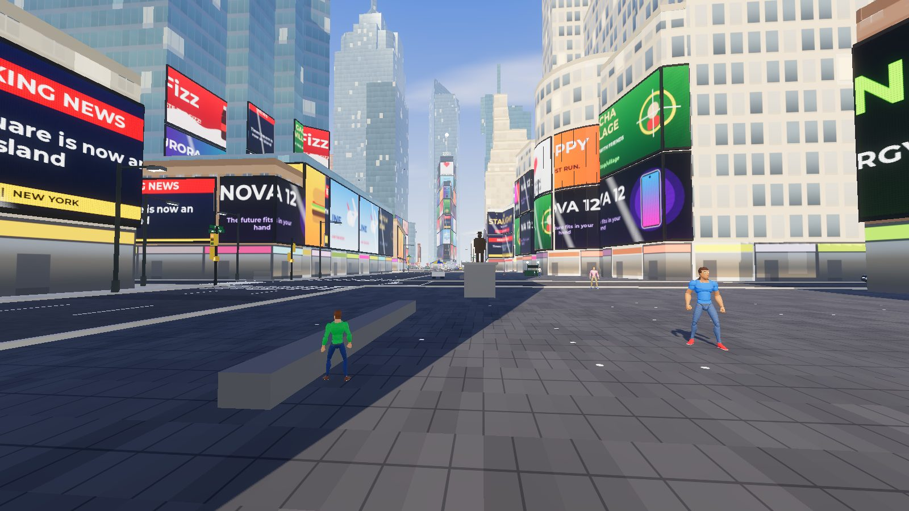

<h1 align="center">Smash Atlas</h1>

  <b>A multiplayer third-person sandbox in real places rebuilt 1:1 from the map.</b> Grab a pistol or a baseball bat
  and roam Times Square, cut out of Manhattan and set adrift as an island, or an autumn panel-housing estate in
  Czechia or Siberia: villagers who run when they see you armed, yellow cabs that stop at the lights, LED screens,
  kids at the playground, a walk-in supermarket and birds overhead. Everyone who opens the game shares the same world.

  <a href="https://maxims.top/village/"><b>▶ Play in the browser</b></a> ·
  <a href="https://github.com/msveshnikov/smash-atlas/releases/latest/download/SmashAtlas.exe">Windows .exe</a> ·
  <a href="https://github.com/msveshnikov/smash-atlas/releases/latest/download/SmashAtlas.apk">Android .apk</a> ·
  <a href="https://github.com/msveshnikov/smash-atlas/releases/latest">All releases</a>

  
  
  
  
  

### Features
- **Times Square, New York.** 41st to 48th Street between 6th and 8th Avenue, about 300 m round the bowtie,
  every one of 427 buildings extruded from its OpenStreetMap footprint and height (Bank of America Tower,
  4 Times Square with its mast, the Marriott Marquis, the Broadway theatres), set adrift as an island ringed by a
  waterfront promenade and the open sea. LED screens wrap every facade that faces the square, One Times Square
  carries its ball and news ticker, the TKTS red steps glow in Duffy Square, yellow cabs follow the real one-way
  streets and stop at the lights.
- **A real place, 1:1.** About 200 m of a Czech panel-housing estate, rebuilt in metres from the satellite map and
  Street View: five-storey blocks with loggias, sixteen-storey towers, garages, a playground, a supermarket, a hill.
- **Seven places to play.** Pick Times Square, Moscow’s Red Square, Neratovice or either Omsk estate in the main
  menu. With 10,000 leaderboard points, you can also visit Montmartre in Paris or Grafton Street in Dublin.
- **Pistol, baseball bat, empty hands.** A small CS-style crosshair, hitscan shots with a real gunshot sound,
  tracers and bullet holes. Players can shoot each other: a headshot kills, body hits take 15-34 depending on
  how close to the heart, a bat blow 30. Shoot a car and it blows up, then burns for minutes in a column of
  black smoke; anyone standing next to it dies. Take the bat to a car instead and it caves in where you hit it,
  the windows craze and crumble and the alarm goes off; in Times Square the shop windows crack, then smash out
  with glass all over the pavement, and it all stays that way. Villagers flee as soon as they see you armed; the dead stay lying
  in a pool of blood while new ones are born elsewhere.
- **Mobile vibration.** Bazooka recoil and nearby car and rocket explosions trigger vibration on supported phones.
  The pulse fades with distance, and a stronger explosion can replace a pulse already playing.
- **A proper main menu.** The chosen place full-screen behind the logo; PLAY, SHOP, SETTINGS (graphics quality,
  render scale, shadows, fullscreen, volume, city ambience, look sensitivity, invert Y), HOW TO PLAY; your name,
  your cash, who else is online there, and a card for each place. In the game, Esc (or the pause button on a
  phone) brings up the pause menu.
- **Smash for cash, then shop.** Every dent, cracked or smashed shop window and blown-up car pays out in gold coins
  that pop out and fly into your pockets when you walk up to them. Spend them on outfits or on Alice, a second
  character. Money and looks are saved on the device. You drop a quarter of your cash when you die.
  From the pause menu's shop, drink whiskey for $100 to restore up to 100 HP.
- **Heat and the police.** Violence fills a heat meter that cools off slowly while you behave. When it tops out a
  patrol car comes in along the streets with lights and siren, and two officers, a man and a woman, get out and
  shoot back for real. Put both down to clear the heat (they drop $150), or outrun them to halve it.
- **A living autumn afternoon.** Swaying coloured crowns, falling leaves, cumulus clouds, traffic that stops for
  people, flocks of birds, washing on the loggias, and ambient sound.
- **Multiplayer in the browser.** Open the link, see the other players with their names; a tiny WebSocket relay
  keeps everyone in one world.
- **Cars built in Blender by script.** Škoda Octavia, Fabia and friends, generated by Python, in the usual street colours.

| | |
|---|---|
| 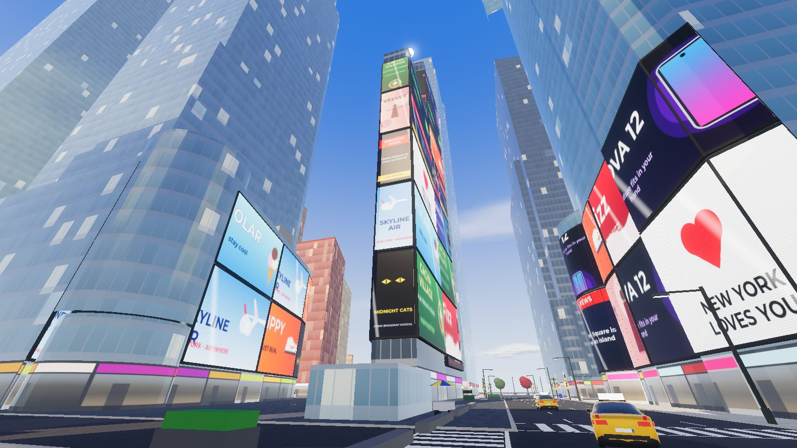 | 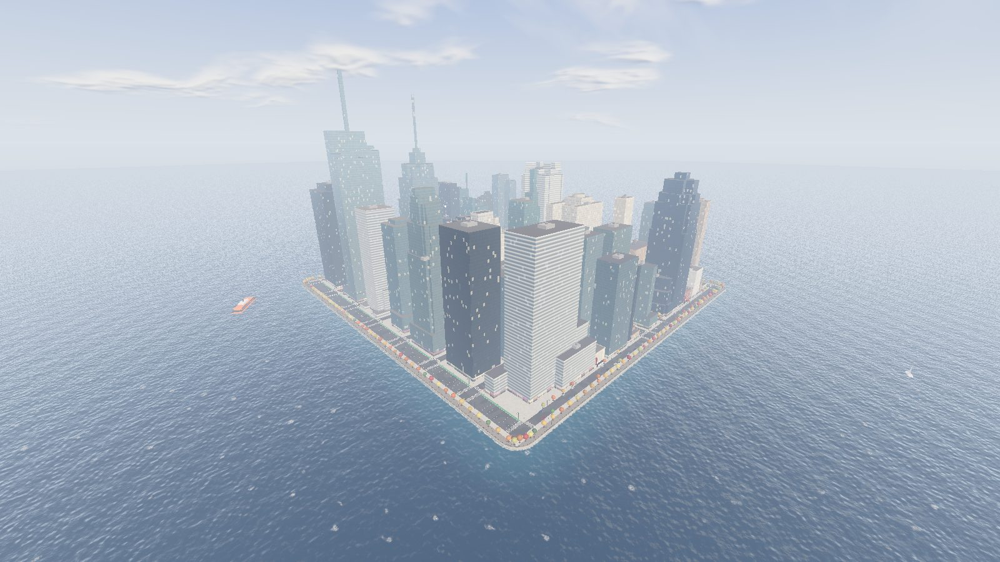 |
| 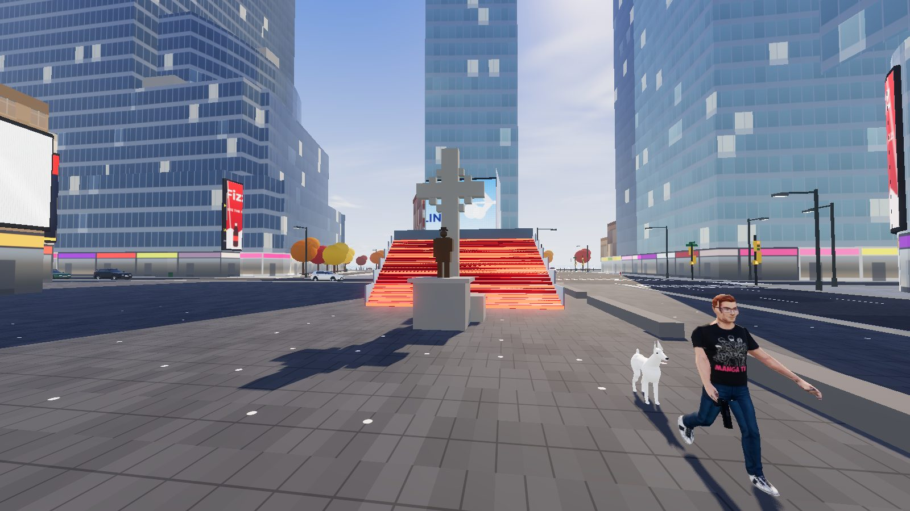 | 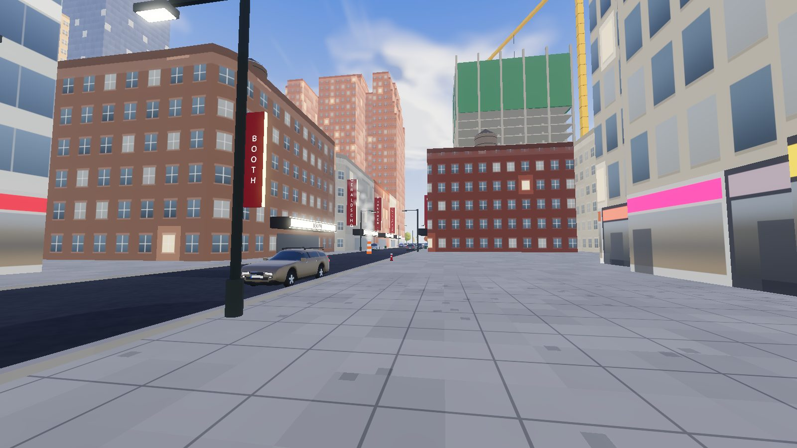 |
| 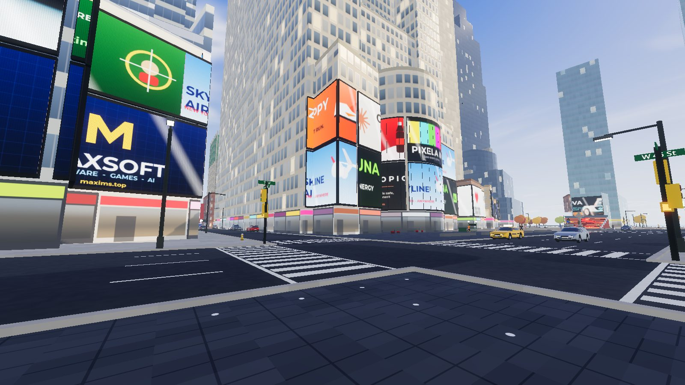 | 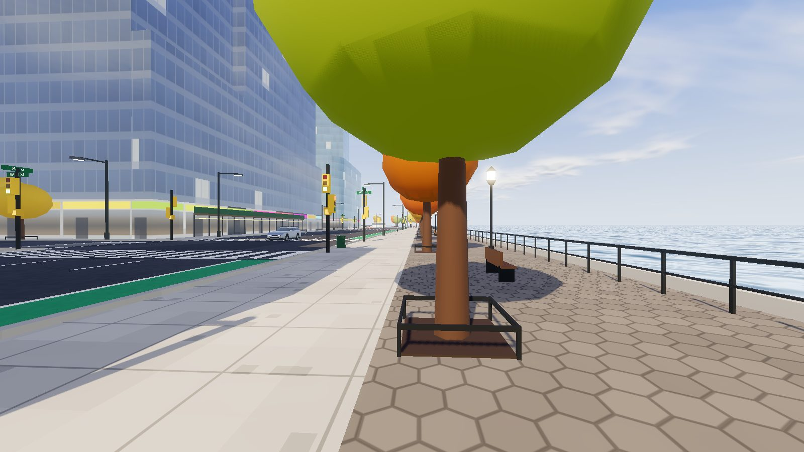 |
| 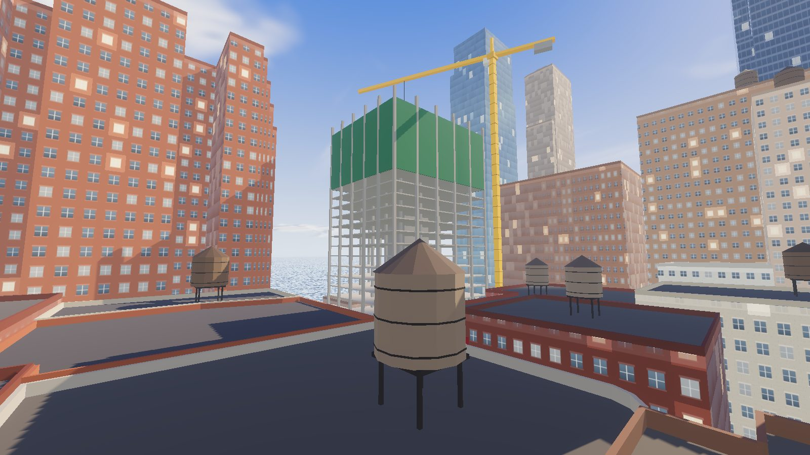 | 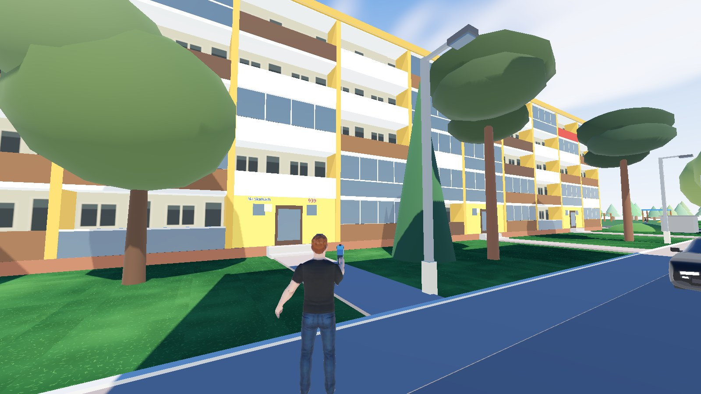 |
| 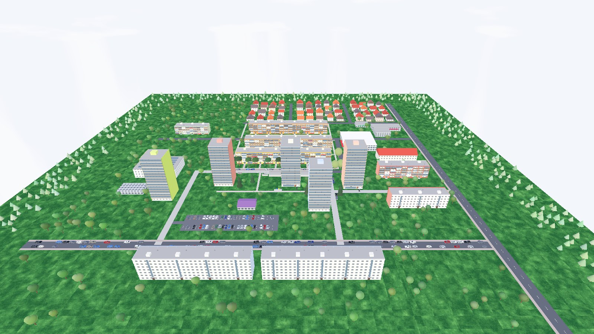 | 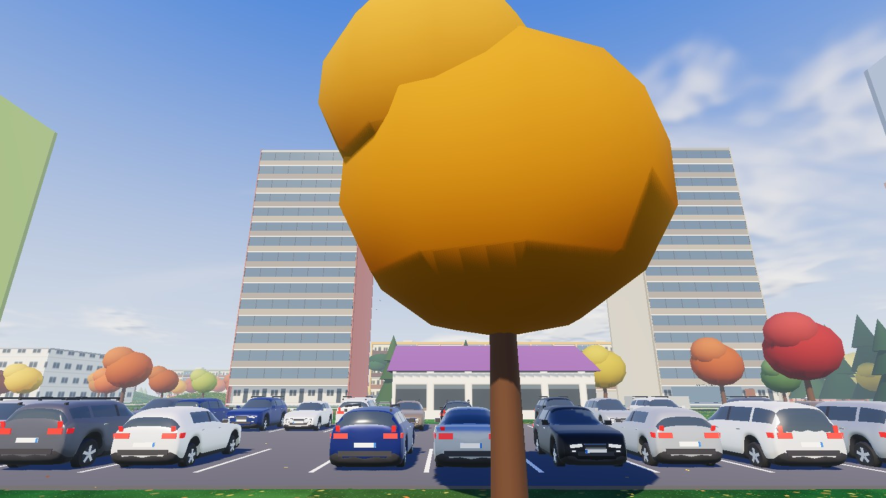 |
| 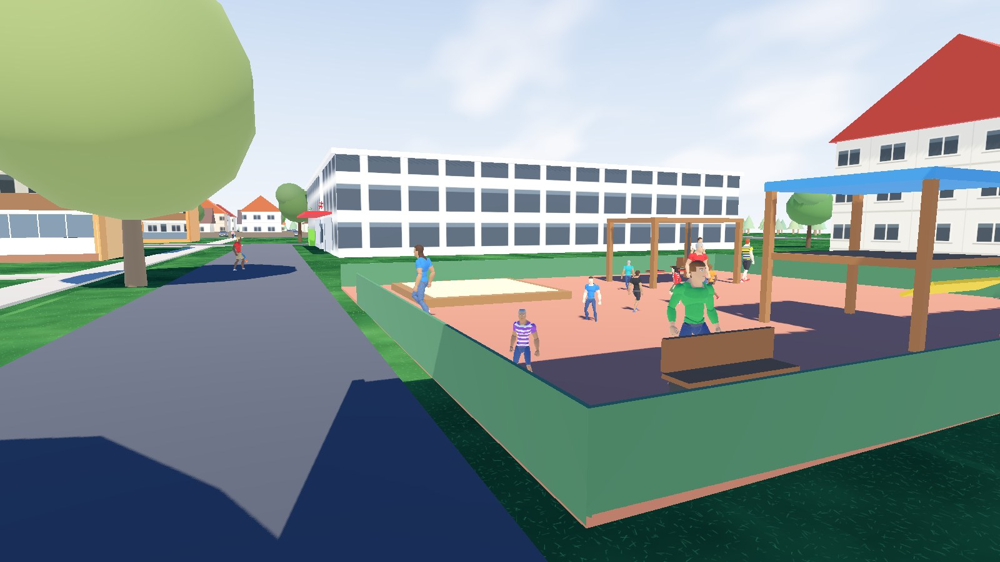 | 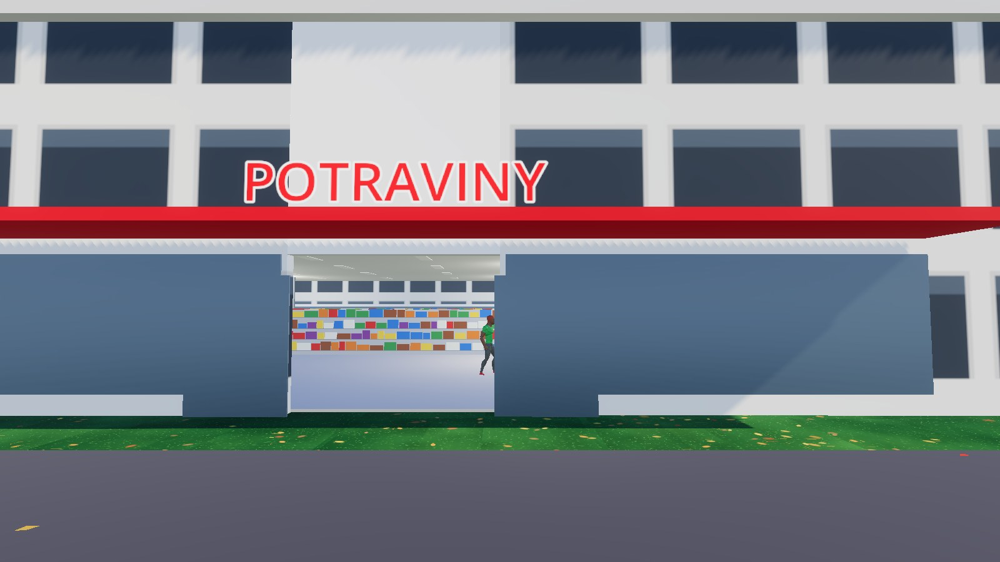 |
| 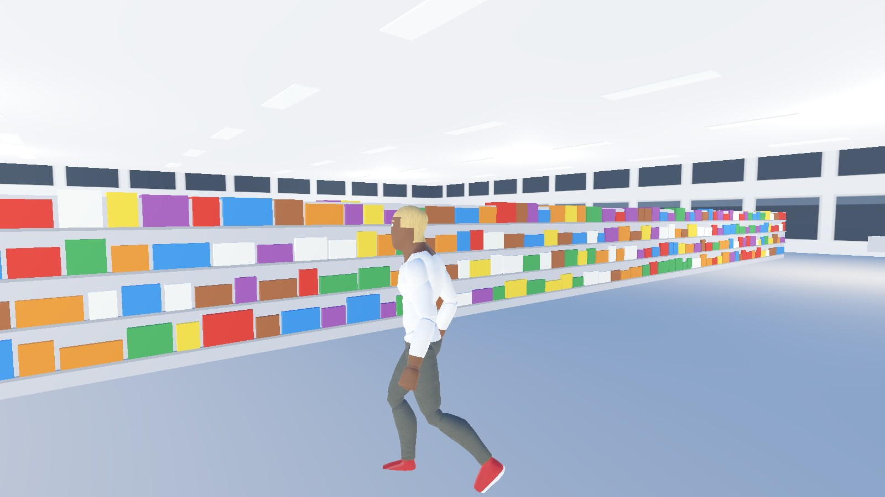 | 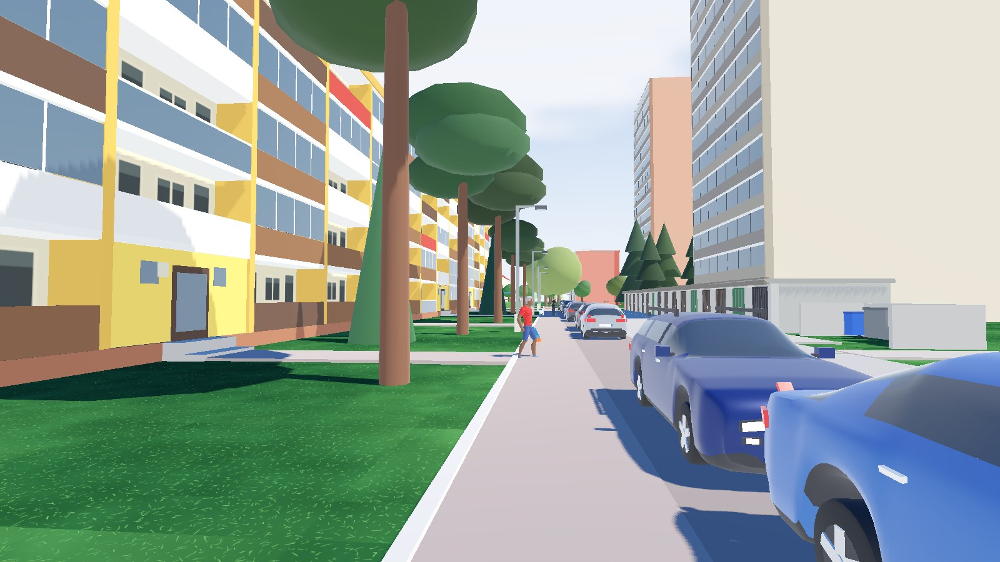 |
| 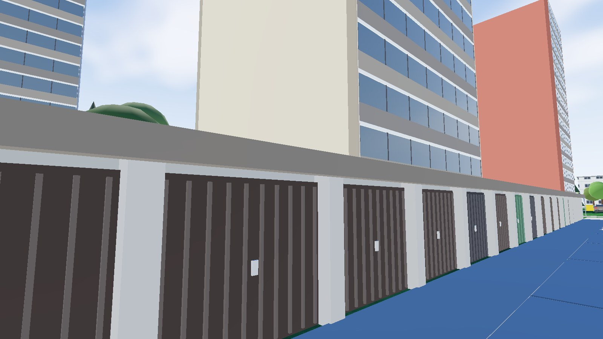 | 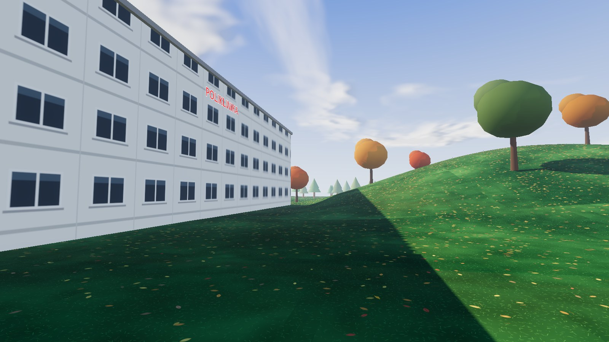 |
| 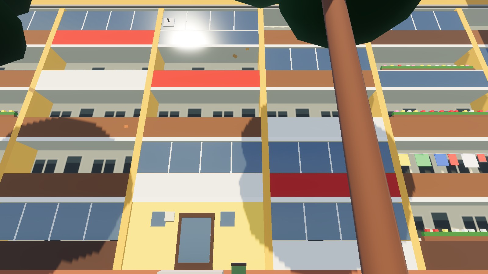 | 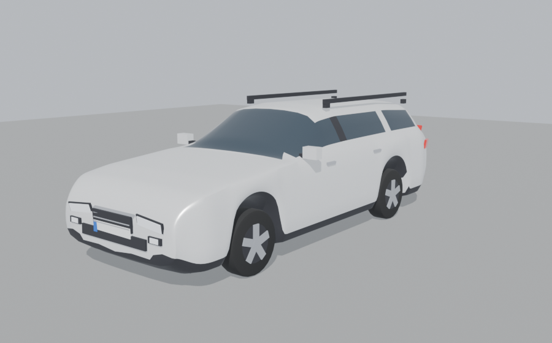 |

## Alice
The second player character (`female_player.glb`) is made from a turnaround sheet ChatGPT painted from a text
prompt (`concept/characters/alice_sheet.png`: front, right side and back, A-pose, on white), the way Max's model
carries his own sheet:

1. `python blender/scripts/alice_sheet.py` cuts the three silhouettes out of the white, builds her body as a voxel
   volume (every height slice a set of ellipses, as wide as the front view and as deep as the side view; arms split
   from the torso above the armpit; the head from a smoothed face width and an ellipsoid skull, so the hair hanging
   beside the face doesn't widen the jaw; the ponytail round where the side view sticks out behind), smooths it and
   turns it into a surface with marching cubes, and measures the joints for the rig.
2. `blender -b --factory-startup -P blender/scripts/build_female_player.py` thins it to ~20k triangles and projects
   the sheet onto it: the head behind the eyes and the legs below the hands from the side view, everything else from
   the front or the back (in the side view the arms are drawn over the torso and the profile over the cheeks).

Her joints differ from Max's (hips 0.92 m, shoulders 1.375 m, 0.173 m out), so `BODIES` in
`player_model_animator.gd` holds each body's rig and the shader's regions (`player_body.gdshader`: hips, knees,
shoulders, where the arms start above and below the waist, the T-shirt and jeans for the shop's colours). The
cap and sunglasses sit by `HEADS`. Previews in `blender/renders/alice_*.png`; `tools/gait_test.gd` renders either
body running, aiming and swinging.

`blender/scripts/fix_max_uvs.py` cleaned up Max's head the same way: his cheeks no longer show the profile's
nose and glasses, and the underside of his jaw shows neck skin instead of the stretched chin line.

## Menus
`main_menu.tscn` (`main_menu.gd`) is the first scene: a picture of the chosen place (`assets/ui/place_*.webp`,
rendered by `tools/tour.gd`), the buttons on the left, the player card and the place cards on the right; picking
a place joins its room right away, so the card shows who is online there. PLAY puts up `loading_screen.gd` on the
tree's root, loads `node_2d.tscn` in the background and switches to it; `world.gd` takes the loading screen down
once the place is built. `settings.gd` (autoload `Settings`) keeps graphics, sound and controls in
`user://settings.cfg` and applies them to the running scene; `settings_panel.gd` is the panel for them, shared by
the main menu and the pause menu. Every menu uses `ui_theme.gd`. `tools/menu_test.gd` walks through all of it.

## Money, heat and the police
- **Coins** (`coins.gd`): `player_controller.gd` pays out for what the player breaks: a dent $5 (the first six per
  car), a cracked shop window $10, a smashed one $25, a car blown up $40. The coins hop out, settle spinning and
  fly into the player within 2.4 m. `game_state.gd` (autoload `Game`) keeps the money and the shop's catalogue,
  saved in `user://progress.cfg`.
- **Heat** (`police.gd`): a villager killed adds 20, a car blown up 30, a smashed window 10, a cracked one 5, a
  dent 3; after four calm seconds it drops 3 a second. At 100 a patrol car (a white Octavia with a blue band,
  light bar and siren) drives in over the bot street graph (`path_between` in `bot_crowd.gd`) and stops about
  13 m off; two officers (`police_officer.gd`, the villager mannequin in navy uniform and peaked cap) get out,
  run in until they see the player, then circle at 7-15 m and fire hitscan rounds, 7-12 damage, likelier to hit
  the nearer and stiller the player is. A headshot kills an officer; body shots take three or four. Both down:
  heat 0 and $150 in coins. Run 75 m away for 12 s: they lose you and the heat drops to 50. Die: they leave,
  the heat is gone and so is a quarter of your cash. The police are local to each player.
- **Shop** (`shop.gd`): the character on a turntable and every item as a button; owned ones are put on at once,
  ones you can't afford are tried on. Looks are drawn by `player_body.gdshader` (the dark T-shirt and the blue
  jeans repainted; cap and sunglasses are small meshes with the same shader so they move with the body) and sent
  to the other players as a short look code.

## Playable estate
The main scene (`node_2d.tscn`) is a third-person village shooter with the custom player character and an over-the-shoulder camera. Every player appears at a random spot inside the panel-housing estate. Switch between a black pistol (tucked at the hip, snapped up to aim when firing; hitscan along the crosshair with muzzle flash, recoil, tracer, bullet holes and blood), a baseball bat (overhead swing) and empty hands. Other players can be shot (`pistol_damage` in `player_controller.gd`: head 100, chest 24-34, belly 20-28, legs 15-20, the nearer the middle of the body the more; bat 30), with a hit marker for the shooter, a kill feed for everyone and two seconds of spawn protection. A round into a car (parked or driving) blows it up (`car_fire.gd`): fireball, flash, flying debris and a bang heard across the estate; anyone within 2 m dies, up to 6.5 m gets hurt, villagers within 4.5 m die. The charred shell then burns for two and a half minutes and smokes for another minute and a half; parked wrecks stay for good, a burnt car in the traffic stops where it was hit (the cars behind queue up) and is towed away once it has burnt out. The bat does no fire but plenty of damage (`car_damage.gd`): the car gets its own copy of its mesh, pushed in round each blow with the normals rebuilt, so it stays battered; windows hit craze (`car_glass.gdshader`) and crumble on the second blow; a parked car's alarm wails with the lights flashing, a driver honks and drives on dented. In Times Square the shop windows break too (`smash_window` in `nyc_builder.gd`, drawn by `facade.gdshader` from a one-texel-per-window damage map): the first blow or bullet cracks a spider web round where it landed, the next smashes the pane out leaving jagged teeth in the frame, and the shards stay on the pavement (`glass_fx.gd`). Dents and broken windows are replayed on every player's screen. Sixteen villagers roam the streets carrying pistols but never fire back (`shoots_back` in `villager_walk.gd` turns that on again); they run away as soon as they see you armed. A bullet or a bat blow kills one; its body stays lying where it fell (the newest 30 are kept) and a new villager in other clothes is born far from the players after a short delay. Parents and kids play at the playground and shoppers and cashiers fill the supermarket; they run from an armed player too but can't be hurt. The estate (`district.gd`) is the real neighbourhood around Na Skalkách in Neratovice, rebuilt 1:1 in metres from the satellite map and Google Street View, in detail for about 100 m around the home block and out to ~200 m with the surrounding streets (Dr. E. Beneše, 28. října, Za Jednotou, J. K. Tyla, Lomená, Travní), the long blocks on Beneše, the poliklinika, the family-house quarter, five sixteen-storey towers and a walk-in supermarket (POTRAVINY) with aisles, fridges and checkouts. Near the home block: the three 107 m five-storey panel blocks with full-width loggias (ochre fins, white slabs, brown/white/red/glass railings, yellow stair entrances), the point towers across Na Skalkách with their coloured end walls and ground-floor shops (salon, florist), the old garage row opposite the home block, the concrete and mesh bin pens with sorting bins, street lamps, P signs, the spruce grove with red pipe railings, the playground, the white commercial hall (Restaurace Skleník, AlzaBox), the purple-roofed shop, trees, and parked cars modelled in Blender after the ones on the street (Škoda Octavia Combi and liftback, Škoda Fabia, a compact SUV and an MPV, in the usual silver/white/grey/black/blue/red), all surrounded by forest. Roads, paths and entrance steps lie flush with the ground and have no colliders, so you can run anywhere without jumping.

### Omsk 1 and Omsk 2
Two more estates, picked with the place cards in the main menu (the choice is remembered; `?loc=omsk1` / `-- --loc=omsk2` force one). Both are measured from the satellite map and Street View out to ~200 m and built by `district_omsk.gd`, which, unlike the Neratovice builder, lays out every building in its own frame so blocks can stand at any angle; `district_omsk1.gd` and `district_omsk2.gd` hold the layouts, the bot street graphs, the spawn points and the traffic.
- **Omsk 1**: grey-panel five-storey khrushchyovkas re-roofed with red pitched roofs, stacked balconies (glazed in white PVC, old wood or open sheet railings), entrances with concrete canopies and benches; a main road with a T-junction and parked cars, a street running off at an angle with a slanted block along it, two kindergartens, a school with a court, yards with playgrounds, container sites, clotheslines, a grocery and a beer shop, poplars along the road and birches everywhere.
- **Omsk 2**: a 100 m nine-storey panel slab with loggias and an L-shaped neighbour, brick garages, a tyre shop, a gas station and the old private sector. Follow Latvian Street or 10th Cheredovaya into the northeast extension. It includes the five-storey No. 23 with its six entrances, neighbouring courtyards, the Kosmodemyanskaya Library, the Krymskaya lanes and Poltoratskogo Street. The extension's street and building geometry is based on [OpenStreetMap](https://www.openstreetmap.org/way/81146264).

### Times Square, New York
The default place for new players (`?loc=nyc` / `-- --loc=nyc`), built by `district_nyc.gd` on top of `nyc_builder.gd`. It covers the blocks from West 41st to West 48th Street between 6th and 8th Avenue, about 300 m round the bowtie where Broadway crosses 7th Avenue; the street grid is turned 29 degrees so the avenues run straight north-south in the game. The four boundary streets run along a waterfront promenade of hexagonal pavers with a black iron railing, benches, old lamp posts and trees, on a granite sea wall; beyond it the open sea with ferries, a tug and a yacht circling the island (`ocean.gdshader`).
- **Buildings from OpenStreetMap.** `tools/nyc/osm_to_json.py` turns an Overpass dump into `assets/nyc/times_square.json`: 427 footprints and building parts with their heights and setbacks, plus street trees and the street lines. Each one is extruded at load time with a procedural facade shader (`facade.gdshader`: brick and limestone with punched windows, glass curtain walls, ribbon windows, concrete grids, shop fronts with lit sign bands at street level), named landmarks get the look they have on Street View, older roofs carry wooden water tanks.
- **The square.** LED screens on every facade that looks onto the square, wrapped round the corners and stacked in tiers (`screen.gdshader`); the ads are painted once at load time into an atlas (`nyc_ads.gd`): about every other screen shows NOVA (the AGI robot you print yourself, with its Blender renders), MaxSoft, Claude or Anthropic, the rest made-up brands. One Times Square is covered in screens almost to the top, with the news ticker round it and the ball on its mast over the lit year. The dark plaza pavers with steel discs, granite benches, café tables, hot dog carts, the TKTS booth under 24 glowing red steps you can climb, George M. Cohan and Father Duffy with his Celtic cross, the NYPD station in blue neon and the recruiting booth with its neon flag.
- **The streets.** Real roadway widths and one-way directions: 7th Avenue south, 8th and 6th north with green bike lanes, even streets east, odd ones west, 42nd both ways with red bus lanes. Granite kerbs, high-visibility crosswalks, traffic lights on every corner with green street-name signs, lamps, hydrants, trash cans, mailboxes, newsstands, Con Ed steam stacks venting, sidewalk sheds, subway entrances with green globes, Broadway theatres with marquees and vertical blade signs, and The Torch going up on 8th Avenue under a tower crane. Yellow cabs (`car_taxi` in `build_vehicles.py`) are half the traffic; the cars follow the signal cycle (`traffic.gd`, the same wall clock on every client) and keep clear of each other where lanes cross.

### Red Square, Moscow

Red Square (`?loc=moscow` / `-- --loc=moscow`) is open to all players and has its own multiplayer room.
The stylized cobblestone plaza is framed by the Kremlin wall and its clock tower, GUM, the Historical Museum
and Saint Basil’s Cathedral. Half of the armed NPCs wear olive-green uniforms and peaked caps.
The surrounding streets are playable out to a 300 m radius, enclosed by a masonry wall.
Breakable shop windows line GUM and nearby streets. Cars circle the square and park in marked bays.
Pedestrians stay on their own routes around the surrounding streets. Zaryadye Park has an amphitheatre under a
glass canopy and a walkable floating bridge. Through the Kremlin’s arch, a stylized courtyard and indoor gallery
have their own armed NPCs.
Forty more NPCs patrol the footpath along the outer wall, with five residents per sector.

### Montmartre, the Grands Boulevards and Grafton Street

The Grands Boulevards and Grafton Street have a roughly 250 m playable radius. Paris extends north to Montmartre.
Masonry walls close off the edge, with city buildings beyond.
Street centerlines and building footprints in the original districts use metre coordinates from OpenStreetMap. The procedural buildings
use tagged heights and floor counts where available, with estimated heights, widths, and facade detail elsewhere.
Google Maps and Street View were visual references for street layout, materials, signs and landmark exteriors.
Armed adult NPCs patrol the main streets and surrounding side lanes.

- **Paris** (`?loc=paris`) starts near Musée Grévin and Théâtre des Variétés. It includes rue Vivienne,
  rue du Faubourg Montmartre, the beginning of boulevard Poissonnière, café terraces, Morris columns,
  Grands Boulevards métro entrances, and walkable portions of Passages Jouffroy and des Panoramas.
  Follow rue du Faubourg Montmartre north to the Boulevard de Clichy, the Moulin Rouge with its turning red sails,
  and the terraced climb through Square Louise Michel to the Sacré-Cœur basilica. The northern route compresses
  the distances between the landmarks for play. Roughly half the crowd carries baguettes in paper sleeves.
  Traffic loops on the Grands Boulevards and Boulevard de Clichy.
  [Montmartre reference](https://parisjetaime.com/eng/article/village-paris-a922)
  · [Moulin Rouge](https://www.moulinrouge.fr/en/homepage/)
  [Google Maps](https://www.google.com/maps/search/?api=1&query=Mus%C3%A9e+Gr%C3%A9vin+Paris)
  · [Street View](https://www.google.com/maps/@?api=1&map_action=pano&pano=ohH5edyRZTLShDAQAJhbLg&heading=340)
- **Dublin** (`?loc=dublin`) follows granite-paved Grafton Street between Suffolk Street and St Stephen’s Green,
  with Bewley’s, Harry Street and Phil Lynott, Brown Thomas, King Street South and the Gaiety Theatre.
  Follow Anne Street South to St Ann’s Church or continue to the Fusiliers’ Arch at the park entrance.
  The classic Stephen’s Green Shopping Centre has three ironwork balconies above the shopfronts and a tall
  glass dome. Luas-inspired shuttles carry seated passengers beside the park and along both Dawson Street
  tracks. A direct bazooka hit can wreck each tram separately. Cars follow loops and yield at track crossings.
  [Historic facade reference](https://www.mortarandmore.com/news/2024/01/st-stephens-green-shopping-centre)
  · [Luas fleet reference](https://www.tii.ie/en/public-transport/luas/trams-and-depots/)
  [Google Maps](https://www.google.com/maps/search/?api=1&query=Bewley%27s+Grafton+Street+Dublin)
  · [Street View](https://www.google.com/maps/@?api=1&map_action=pano&pano=Eq-HcjYw9RWKyJcC4ADaQQ&heading=263)

The district cards and relay use the same 10,000-point threshold from the persistent leaderboard.
The exact lower-case Cyrillic test nickname `макс` unlocks both districts immediately.

Map data © [OpenStreetMap contributors](https://www.openstreetmap.org/copyright) (ODbL).

Every place has its own multiplayer room (Neratovice keeps the old one), so players meet only the people in the same place.

### Autumn atmosphere
It is an autumn afternoon: deciduous crowns in yellow, orange and red sway in the wind (`tree_crown.gdshader`), fallen leaves cover the grass (`grass.gdshader`), lie on the paths and roads and drift down around the player. The sky has lit cumulus with grey undersides, high cirrus, a sun halo and horizon haze, with distance fog and a soft glow. Grassy hills rise in the open ground (flattened near anything built, with height-map collision). Loggias carry flower boxes, washing, satellite dishes and curtains; there are graffiti tags on the garages, a bus stop on Beneše, clotheslines between the blocks, bins and benches at the entrances, swings that swing, flocks of birds overhead (`birds.gd`) and cars driving along Dr. E. Beneše and 28. října that stop for people (`traffic.gd`).

Sound (`ambience.gd`, files in `audio/`, see `audio/CREDITS.md`): distant city hum, wind and birdsong everywhere, creaking swings at the playground, an engine hum on every passing car, a whoosh and crack for the bat, a recorded 9 mm gunshot for the pistol (CC BY-SA, Wikimedia Commons), and a real explosion and crackling fire for burning cars (public domain). The hum, wind, engine and creak are synthesised by `audio/make_sounds.py`, the shattering shop window, the dent, the car alarm and the horn by `audio/make_smash_sounds.py`, with Kenney's CC0 glass clinks on top; the birdsong is CC0 from OpenGameArt.

### Multiplayer
Everyone who opens the game (web link or the Android APK) lands in the same world and sees the other players, with their names over their heads. Ten armed villagers roam the estate's roads and footpaths and loiter around; shoot one and its body stays while a new one is born somewhere far from all players. Players hurt each other too: the shooter decides the hit and sends the damage to the victim, who reports the kill to everyone.

- **Server**: `server/relay.js` (Node + `ws`) is a tiny WebSocket relay at `wss://severance.lol/village-ws`. It forwards each client's JSON messages to the others in the same room and picks one client as the *host*, which simulates the bots and streams their positions; if the host leaves or its tab goes to the background, another client takes over. Deploy/update with `server/deploy.sh` (systemd service `village-relay` on 127.0.0.1:8091 behind nginx).
- **Usage log**: the relay logs every session to the journal (`journalctl -u village-relay`): country (nginx GeoIP2), platform and game version, player name and renames, kills, session length and a count of messages by type. Finished sessions also go to `~/village-relay/logs/sessions.jsonl` (IPs are never stored, only a salted hash to count unique players); `node ~/village-relay/stats.js 7` prints a per-day summary.
- **Client**: `net.gd` (autoload `Net`) holds the connection, `net_world.gd` streams the local player and shows remote ones (`remote_player.gd`), `bot_crowd.gd` + `villager_walk.gd` run the bots. Without a server the game plays single-player as before.
- **Locations**: each place is its own room on the relay: `main` is Neratovice, the Omsk estates use `omsk1` / `omsk2` (or `<room>-omsk1` with a custom room). Switching place in the menu reconnects to that room and rebuilds the world; the relay needs no changes.
- **Rooms / local server**: `?room=name` or `?server=ws://127.0.0.1:8091` on the web URL; on desktop `-- --room=name --server=ws://...`. `-- --net-debug` auto-starts and prints the network state every 2 s.

### Controls
- **WASD**: Move
- **Shift**: Run
- **Space**: Jump
- **Mouse**: Look around (vertical look is inverted by default)
- **Q or left mouse button**: Fire or swing the bat. Hold to fire the M4A1 automatically.
- **1 / 2 / 3 / 4 / 5 or mouse wheel**: Baseball bat / Desert Eagle / bazooka / empty hands / M4A1
- **Shop**: The M4A1 costs $500 and comes empty. A pack of 30 rounds costs $30.
- **Health**: The game ends when your health reaches zero; use **Respawn** to drop back into the estate at a random spot.
- **Esc**: Release the mouse; click to capture it again
- **Android/mobile**: Move with the floating stick on the left (pull your thumb past the outer ring to run), drag on the right side to look. The big **FIRE** button sits under the right thumb: hold it to keep firing and slide the thumb to aim while shooting; the small **JUMP** and **SWAP** (next weapon) buttons are next to it. While you move, the camera swings round to where you walk and levels out at chest height, so you aim mostly with the stick.

## Building and deploying
- Web: `godot --headless --export-release "Web" build/web/index.html`, then `scp build/web/* ubuntu@severance.lol:/var/www/maxims/village/`.
- Windows: `godot --headless --export-release "Windows Desktop" build/windows/SmashAtlas.exe` (single exe, pck embedded).
- Android: `godot --headless --export-debug "Android" build/android/SmashAtlas.apk` (debug-signed; no release keystore is set up).

Exports ship only what the game can load (`export_files` in `export_presets.cfg`, plus every script and `audio/`, `assets/`), not the whole Cogito demo. After adding a scene, model or sound, regenerate the list: `godot --headless --path . -s tools/update_export_files.gd`.

Rebuild the Times Square data: fetch the Overpass dump with `tools/nyc/overpass_query.txt` (`curl --data-urlencode "data@tools/nyc/overpass_query.txt" https://overpass-api.de/api/interpreter -o raw.json`), then `python -I tools/nyc/osm_to_json.py raw.json assets/nyc/times_square.json`.

Rebuild the Paris and Dublin data with `tools/europe/osm_to_json.py` (Python with Shapely 2.1).
Pass the city id, the corresponding OpenStreetMap JSON export and the destination in `assets/europe/`.
The API bounding boxes are `2.3387,48.86945,2.34635,48.87438` for Paris and
`-6.26435,53.33920,-6.25585,53.34408` for Dublin, in west/south/east/north order.

Screenshot tour (any place; also prints fps and draw calls, `--check` runs the crowd and traffic for 30 s and reports anyone stuck in a building): `godot --path . -s tools/tour.gd -- --loc=nyc --server=ws://127.0.0.1:1 [--only=0,3] [--ui] [--check]` → `screenshots/tour/`.

Rebuild the cars: `blender -b --factory-startup -P blender/scripts/build_vehicles.py` (Blender 5.2, `C:\Program Files\Blender Foundation\Blender 5.2\blender.exe`) → `assets/vehicles/*.glb` + previews in `blender/renders/vehicles/`.
