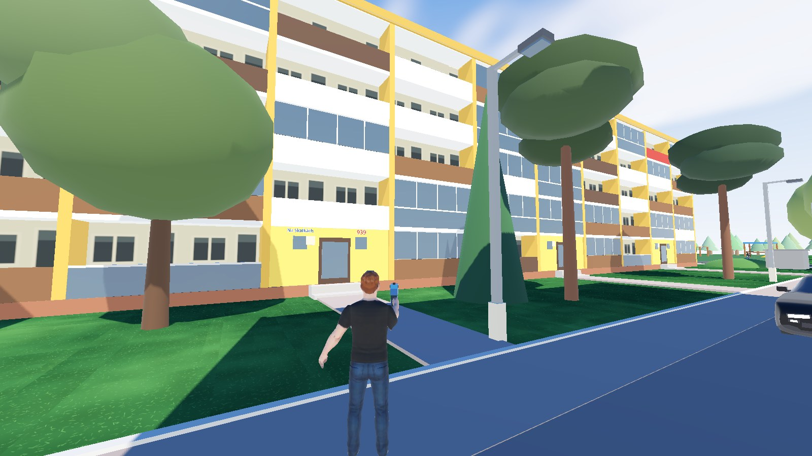
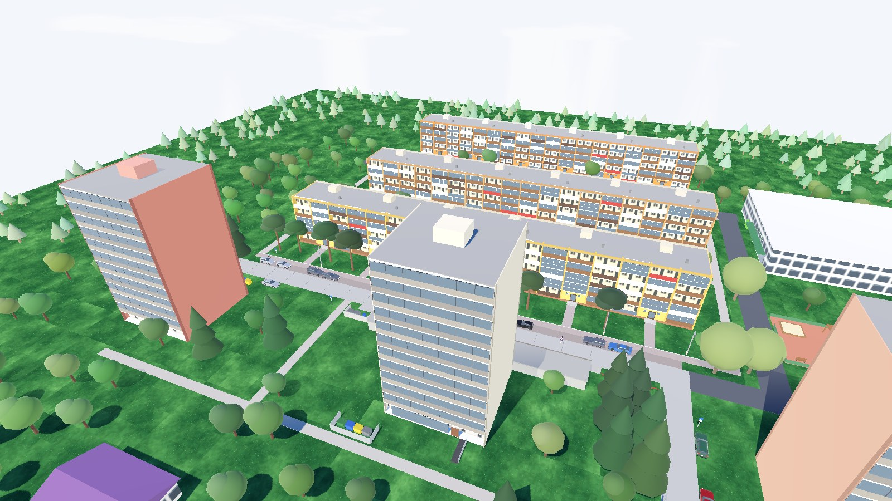
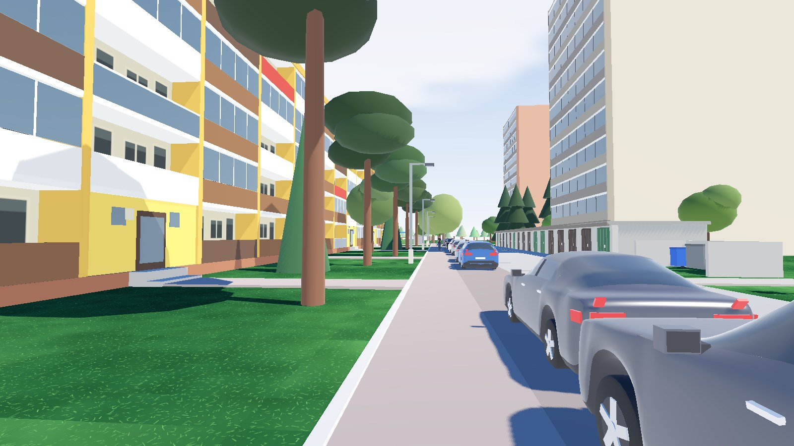
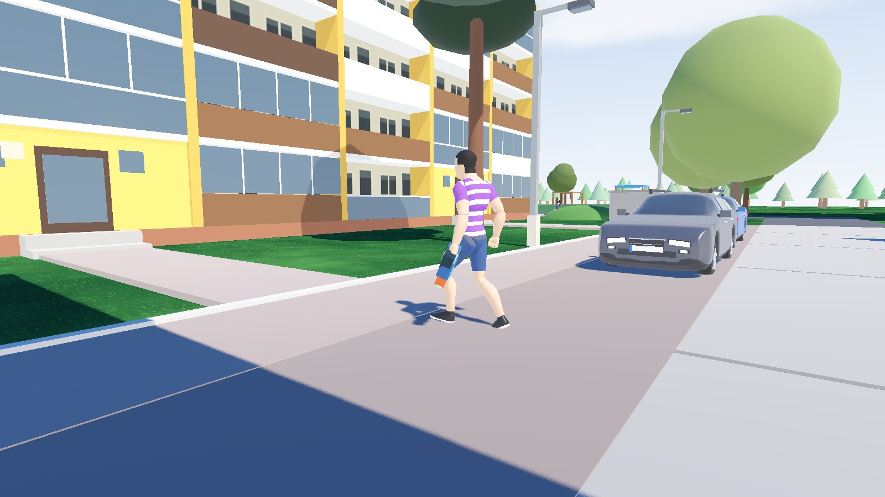
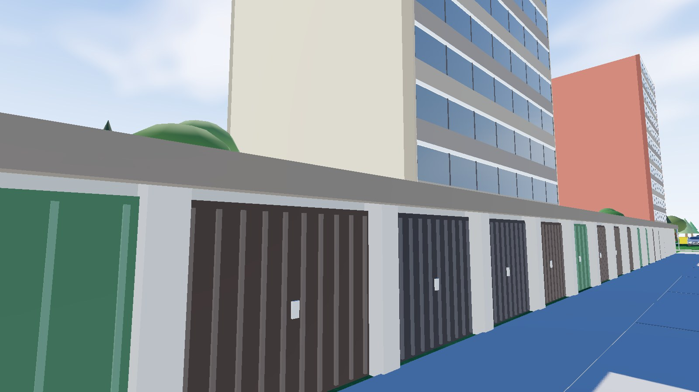
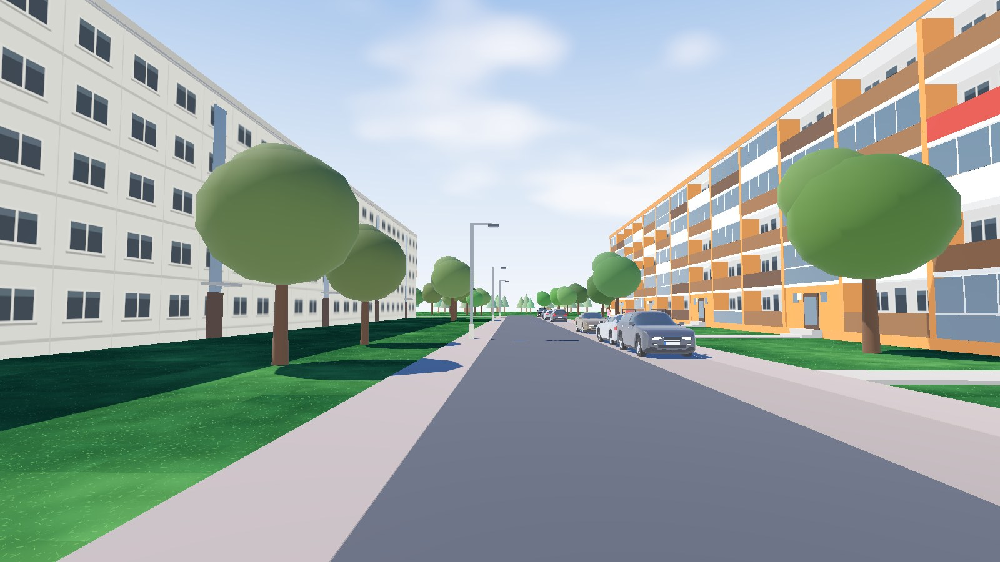
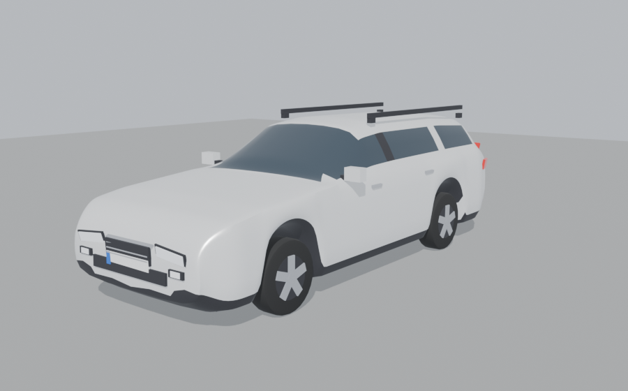

# Gacha Village

**▶ Play: https://severance.lol/3/**

**Downloads:** Windows `.exe` and Android `.apk` on the [Releases page](https://github.com/msveshnikov/godot-game/releases).

Web deploy: `godot --headless --export-release "Web" build/web/index.html` then `scp build/web/* ubuntu@severance.lol:/var/www/severance/3/`
Windows: `godot --headless --export-release "Windows Desktop" build/windows/GachaVillage.exe` (single exe, pck embedded).
Android: `godot --headless --export-debug "Android" build/android/GachaVillage.apk` (debug-signed; no release keystore is set up).

Rebuild the cars: `blender -b --factory-startup -P blender/scripts/build_vehicles.py` (Blender 5.2, `C:\Program Files\Blender Foundation\Blender 5.2\blender.exe`) → `assets/vehicles/*.glb` + previews in `blender/renders/vehicles/`.

| | |
|---|---|
|  |  |
|  |  |
|  |  |

## Playable estate
The main scene (`node_2d.tscn`) is a third-person village shooter with the custom player character and an over-the-shoulder camera. Every player appears at a random spot inside the panel-housing estate holding a foam pistol (tucked at the hip, snapped up to aim when firing). Ten villagers roam it carrying pistols but never fire back (`shoots_back` in `villager_walk.gd` turns that on again); hit one and it disappears and respawns after a short delay. The estate (`district.gd`) is the real neighbourhood around Na Skalkách 939 in Neratovice, rebuilt 1:1 in metres for about 100 m around the home block from the satellite map and Google Street View: the three 107 m five-storey panel blocks with full-width loggias (ochre fins, white slabs, brown/white/red/glass railings, yellow stair entrances; 939 is marked), the three twelve-storey point towers across Na Skalkách with their coloured end walls and ground-floor shops (salon, florist), the old garage row opposite the home block, the concrete and mesh bin pens with sorting bins, street lamps, P signs, the spruce grove with red pipe railings, the playground, the white commercial hall (Restaurace Skleník, AlzaBox), the purple-roofed shop, trees, and parked cars modelled in Blender after the ones on the street (Škoda Octavia Combi and liftback, Škoda Fabia, a compact SUV and an MPV, in the usual silver/white/grey/black/blue/red), all surrounded by forest. Roads, paths and entrance steps lie flush with the ground and have no colliders, so you can run anywhere without jumping.

### Multiplayer
Everyone who opens the game (web link or the Android APK) lands in the same world and sees the other players, with their names over their heads. Ten armed villagers roam the estate's roads and footpaths and loiter around; hit one and it vanishes and respawns somewhere far from all players.

- **Server**: `server/relay.js` (Node + `ws`) is a tiny WebSocket relay at `wss://severance.lol/village-ws`. It forwards each client's JSON messages to the others in the same room and picks one client as the *host*, which simulates the bots and streams their positions; if the host leaves or its tab goes to the background, another client takes over. Deploy/update with `server/deploy.sh` (systemd service `village-relay` on 127.0.0.1:8091 behind nginx).
- **Client**: `net.gd` (autoload `Net`) holds the connection, `net_world.gd` streams the local player and shows remote ones (`remote_player.gd`), `bot_crowd.gd` + `villager_walk.gd` run the bots. Without a server the game plays single-player as before.
- **Rooms / local server**: `?room=name` or `?server=ws://127.0.0.1:8091` on the web URL; on desktop `-- --room=name --server=ws://...`. `-- --net-debug` auto-starts and prints the network state every 2 s.

### Controls
- **WASD**: Move
- **Shift**: Run
- **Space**: Jump
- **Mouse**: Look around (vertical look is inverted by default)
- **Q or left mouse button**: Fire a foam pellet (unlimited ammo, no reloading)
- **Health**: The game ends when your health reaches zero; use **Respawn** to drop back into the estate at a random spot.
- **Esc**: Release the mouse; click to capture it again
- **Android/mobile**: Use the on-screen joystick to move, drag on the right side to look, and tap **E** to interact. The on-screen buttons also provide jump, run and pistol fire.
